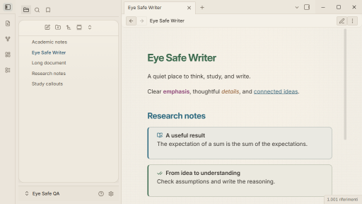

# Eye Safe Writer

Warm paper surfaces, quiet chrome, and eight light/dark palettes for Obsidian.
Version **1.8.2** requires **Obsidian 1.13.0 or later**.



## Features

- **Salvia, Gruvbox, AMOLED, Tokyo Night, Rose Pine, Solarized, Nord, and Cappuccino**, each in light and dark mode.
- Reading View, Live Preview, and Source Mode styling; local system fonts and embedded textures, with no remote CSS assets.
- Optional **Study, Writing, Code, and Academic / Research** typography presets.
- Palette, emphasis, headings, links, line width, density, ribbon spacing, panels, and texture controls through [Style Settings](https://github.com/mgmeyers/obsidian-style-settings).
- English/Italian study and academic callouts using ordinary Obsidian Markdown.
- Keyboard focus indicators, reduced-motion support, system high-contrast/forced-color fallbacks, and print/PDF styles.

The name is not a medical or universal accessibility guarantee. Built-in colors are tested against specified surfaces. Custom colors, snippets, plugins, and intentional dimming can change contrast. See the [1.8.1 accessibility audit](docs/RELEASE_AUDIT_1.8.1.md) for measured results and the [1.8.2 release audit](docs/RELEASE_AUDIT_1.8.2.md) for the mobile fix.

## Install and update

### Manual installation

1. Download **both** `theme.css` and `manifest.json` from a [published GitHub release](https://github.com/nicolamoscufo/eye-safe-writer/releases).
2. Inside your vault, put them in `.obsidian/themes/Eye Safe Writer/`.
3. Select **Settings → Appearance → Themes → Eye Safe Writer**.
4. Optionally install **Style Settings** through Obsidian's Community Plugins browser.

To update, replace both files together. Notes and saved Style Settings preferences are not removed. Do not install the `src/` modules individually.

### Community Themes

Once the theme is listed, use **Settings → Appearance → Manage themes**, search for **Eye Safe Writer**, and install it. Use Obsidian's theme update controls for subsequent releases. Check the Community directory for the current listing status.

## Customize with Style Settings

Open **Settings → Style Settings → Eye Safe Writer**. Existing setting identifiers and saved preferences are retained.

| Preset | Default text size | Line height | Reading width |
| --- | --- | --- | --- |
| Default | 16.5px | 1.72 | 700px |
| Study | 17px | 1.8 | 760px |
| Writing | 18px, system serif | 1.85 | 660px |
| Code | 16px | 1.6 | 1000px |
| Academic / Research | 17px | 1.78 | 820px |

Saved text size, line height, line width, and Obsidian font overrides take precedence. Reset individual overrides to let a preset control them. At narrow widths the default text size is 16px and content fits the view.

- **Left ribbon spacing:** 8px gaps and 36px rows by default. Compact density uses 4px/32px; Spacious uses 12px/40px. Explicit saved ribbon values win. Full-height distribution is optional; crowded action lists scroll.
- **Clear navigation:** prevents intentional chrome/inactive-pane dimming.
- **Enhanced contrast:** strengthens subdued text and reveals navigation, inactive panes, and paragraphs; it disables texture. Prefer this if you need consistently visible controls.
- **Calm / No dimming:** readable defaults. **Deep focus**, custom opacity values, and **Paragraph focus** intentionally reduce contrast away from the current area. Hover or keyboard interaction reveals controls. Previously saved opacity values remain effective; reset them or enable Enhanced contrast if navigation remains too faint after updating.
- **Active writing line** and **Flat editor background:** optional, off by default.
- Manual color overrides are optional and can reduce the tested contrast. Only one legacy palette snippet should be enabled at a time; prefer the built-in palette selector.
- Links are underlined by default so color is not their only cue. Explicitly saved **Clean** links retain their previous no-underline appearance; this preference reduces non-color link identification. Enhanced Contrast restores underlines.

### CSS-only paragraph focus

Live Preview can emphasize an active **editor line**, not a complete multi-line paragraph. Reading View reveals the hovered or keyboard-focused paragraph while the reading area is interacted with. This is not caret-aware paragraph tracking, and Source Mode has no prose-token guarantee. Paragraph dimming is suppressed by Enhanced Contrast, forced colors, and print. No scripts are bundled with the theme.

## Study and academic callouts

These work in every preset. Use a descriptive title in any language:

| Meaning | English type | Italian type |
| --- | --- | --- |
| Definition | `definition` | `definizione` |
| Formula | `formula` | `formula` |
| Example | `example` | `esempio` |
| Exercise | `exercise` | `esercizio` |
| Question / doubt | `doubt` | `dubbio` |
| Theorem | `theorem` | `teorema` |
| Proof | `proof` | `dimostrazione` |
| Lemma | `lemma` | `lemma` |
| Important | `important` | `importante` |

```md
> [!theorem] Linearity of expectation
> $\mathbb{E}[aX+bY]=a\mathbb{E}[X]+b\mathbb{E}[Y]$.

> [!proof]- Proof — expand to read
> Apply linearity of the integral.
```

Native folding (`+`/`-`), nesting, links, and mathematics remain native Obsidian features. Icons and explicit titles convey meaning without color. The built-in `example` and `important` types receive the theme's custom styling; other native types retain their native icons and palette-aware colors. See [study examples](examples/study-callouts.md) and [academic examples](examples/academic-notes.md).

**Academic print layout** opts into serif typesetting and pagination. Normal printing also removes textures/chrome and uses light paper, including when a dark palette is selected. Extremely wide tables may still need shorter cell content or landscape paper.

## Plugin compatibility

Style Settings is optional. Notes and native callouts do not depend on it. Native QA exercises Style Settings and Tasks in an isolated vault; exact tested versions and limitations are in the audit. This is not a guarantee for every plugin or operating system.

The optional [`eye-safe-pomodoro.css`](snippets/eye-safe-pomodoro.css) snippet styles commonly used timer container classes. Copy it to `.obsidian/snippets/` and enable it under Appearance. Individual timer plugin versions are not certified.

## Troubleshooting

- **Mobile note toolbar:** update both theme files to 1.8.2 or later. If you applied the temporary `eye-safe-writer-mobile-toolbar-fix` snippet, disable it after updating.
- **Ribbon/sidebar overlap:** update both theme files, restart Obsidian, and disable obsolete `eye-safe-ribbon-fix` or competing ribbon snippets. The app owns the sidebar toggle; the theme supports both `.mod-left` and `.mod-primary` ribbon classes.
- **Preset appears unchanged:** reset saved typography overrides in Style Settings. They deliberately take precedence.
- **Unexpected palette or low contrast:** disable legacy palette snippets/manual color overrides, then test Enhanced contrast and reset saved opacity values.
- **Clipped plugin controls or overflow:** compare with the default Obsidian theme and other snippets disabled. Report the Obsidian/installer version, OS, palette, preset, plugin versions, and a sanitized example.

Please [report regressions](https://github.com/nicolamoscufo/eye-safe-writer/issues) without private notes or account details.

## Development and releases

`theme.css` and the seven legacy palette snippets are generated from `src/`. See [DEVELOPMENT.md](DEVELOPMENT.md) for reproducible checks, fixture/native testing, screenshots, and the gated draft-release procedure. See [CHANGELOG.md](CHANGELOG.md) for changes. Licensed under [MIT](LICENSE).
