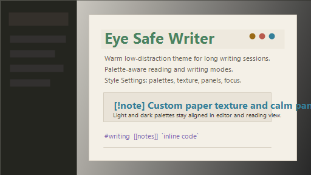

# Eye Safe Writer

Warm, low-distraction Obsidian theme for long writing sessions.



## Features

- Light and dark palettes tuned for eye comfort.
- Style Settings palette selector: Salvia, Gruvbox, AMOLED, Tokyo Night, Rose Pine, Solarized, Nord, Cappuccino.
- Full UI token system controlling workspace, text, accents, navigation, code, tables, callouts, and focus states.
- Typography, line width, headings, links, UI density, compact ribbon spacing, panels, shadows, and paper texture controls.
- Optional Study, Writing, and Code activity presets that respect saved typography preferences.
- Study callouts for definitions, formulas, examples, exercises, and questions, with English and Italian names.
- Writing focus mode with reduced visual distraction and optional clearer navigation.
- Optional current-line guidance and flat editor background for different writing preferences.
- Built-in compatibility layer for productivity workflows.
- Eye Safe Pomodoro integration snippet for focused writing sessions.
- Reduced-motion, high-contrast, forced-colors, print, and small-screen support.

## Install

1. Create `.obsidian/themes/Eye Safe Writer/` inside your vault.
2. Copy `theme.css` and `manifest.json` into that folder.
3. Select **Eye Safe Writer** under **Settings → Appearance → Themes**.
4. Install the optional Style Settings plugin to customize palettes and readability.
5. For Pomodoro support, copy `snippets/eye-safe-pomodoro.css` to `.obsidian/snippets/` and enable it under Appearance → CSS snippets.

To update an existing manual installation, replace `theme.css` and `manifest.json`; your vault notes are unaffected.

## Troubleshooting left sidebar / ribbon overlap

Version 1.6.3 fixes the sidebar toggle overlapping the first ribbon action in Obsidian 1.14+. The theme now supports both the new `.mod-primary` ribbon class and the earlier `.mod-left` class. It also avoids graphical filters that move the toggle into the ribbon action area, including while hovering or focusing the editor.

1. Update **both** `.obsidian/themes/Eye Safe Writer/theme.css` and `manifest.json` from this repository.
2. Fully quit and reopen Obsidian.
3. If you previously enabled an `eye-safe-ribbon-fix` CSS snippet, disable it: the fix is now built into the theme.
4. If the overlap remains, temporarily disable other ribbon CSS snippets and test again; custom snippets may override the theme.
5. Test with Obsidian's default theme: if the issue disappears, check that Eye Safe Writer 1.6.3 or newer is the version actually loaded.

### Ribbon spacing

Actions are grouped near the top with compact spacing by default. To customize it, open **Settings → Style Settings → Eye Safe Writer → Layout and Typography → Left ribbon spacing** (in some Style Settings versions, the section is nested under Layout and Typography):

- **Space between ribbon icons:** default 8px; range 4–60px.
- **Ribbon button row height:** default 36px; range 32–72px.
- **Distribute ribbon icons vertically:** off by default; enable it only if you prefer full-height distribution on tall displays.

The compact UI density preset uses 4px gaps and 32px rows; the spacious preset uses 12px gaps and 40px rows. Explicit ribbon values in Style Settings take precedence. Existing saved preferences are preserved when updating: to match the compact defaults, set the gap to **8**, the row height to **36**, and turn **Distribute ribbon icons vertically** off.

On short windows with many plugin shortcuts, the left ribbon action list scrolls instead of letting buttons shrink into each other.

## Recommended Workflow

Eye Safe Writer works well with:

- Obsidian Style Settings for theme customization.
- Pomodoro Timer plugins for timed deep-work sessions.
- Focus mode plugins for distraction-free writing.
- Daily notes, Canvas, Tasks, and markdown-based knowledge management.

## Style Settings

Available controls:

- Palette variants and light/dark themes.
- Manual colors for links, accents, tags, emphasis, and headings.
- Heading styles.
- Typography scale and reading width.
- UI density.
- Panel appearance.
- Paper textures.
- Writing focus intensity.
- **Clear navigation:** keep tabs, sidebar controls and inactive panes easy to read even when the editor has focus.
- **Active writing line:** optionally highlight the current line in the source editor.
- **Flat editor background:** remove the paper-like vignette while preserving palette colors.

The three new readability options are off by default. Open **Settings → Style Settings → Eye Safe Writer → Readability and Accessibility** to enable them.

## Activity presets

Open **Settings → Style Settings → Eye Safe Writer → Activity Presets → Activity preset**. No additional workflow plugin is needed.

| Preset | Prose font | Text size | Line height | Reading width | Best for |
| --- | --- | --- | --- | --- | --- |
| Default | Current theme font | 16.5px | 1.72 | 700px | Keeping your current appearance |
| Study | Current theme font | 17px | 1.8 | 760px | Notes, explanations, and revision |
| Writing | Georgia / Cambria / system serif | 18px | 1.85 | 660px | Longer prose and drafts |
| Code | Current theme font; code stays monospace | 16px | 1.6 | 1000px | Technical documentation and wider code samples |

Default is selected initially, so an update does not switch your workflow. The numbers above are defaults, not forced values: saved **Text size**, **Line height**, and **Readable line width** overrides in Style Settings take precedence. Reset those individual overrides if you want the preset to control them. Obsidian's custom text font also takes precedence over the preset font.

Presets leave your palette, ribbon spacing, UI density, focus options, and notes untouched. Paragraph spacing changes in Reading view; text size, line height, and width apply in both Reading view and Live Preview. The Code preset uses `0.95em` for rendered code. On narrow windows the reading width fits the screen and the theme's mobile-friendly text sizing remains in effect. Select **Default** to return to the original typography.

## Study callouts

These use native Obsidian callouts, work in Reading view and rendered Live Preview, and do not require an activity preset or another plugin.

| Meaning | English type | Italian type | Icon |
| --- | --- | --- | --- |
| Definition | `definition` | `definizione` | Open book |
| Formula | `formula` | `formula` | Sigma |
| Example | `example` | `esempio` | Flask |
| Exercise | `exercise` | `esercizio` | Pencil |
| Question / doubt | `doubt` | `dubbio` | Question mark |

```md
> [!definizione] Definizione — policy
> Una policy descrive come scegliere un'azione dato uno stato.

> [!formula] Formula — valore atteso
> $$\mathbb{E}[X] = \sum_x x\,P(X=x)$$

> [!esercizio]- Esercizio — prova tu
> Calcola il valore atteso e spiega i passaggi.
```

Use a descriptive title after `[!type]` in whichever language you prefer; the theme never inserts or replaces your text. Icons and titles distinguish the types even without color. The native `+` / `-` folding syntax, nested callouts, links, and math keep working. The built-in `example` type gets the study example styling; other native types keep their normal styles. In Source mode the underlying Markdown remains visible. Without this theme, the content still works as a native callout with fallback styling.

See [examples/study-callouts.md](examples/study-callouts.md) for a complete, copyable study note.

## Pomodoro Integration

The included `eye-safe-pomodoro.css` snippet provides:

- Calm timer cards matching the current theme palette.
- Large readable countdown typography.
- Soft buttons and reduced visual noise.
- Reduced-motion accessibility support.

It is designed to work with modern Obsidian Pomodoro plugins without changing plugin functionality.

## QA Checklist

- Obsidian desktop on Windows, macOS, Linux.
- Obsidian mobile and narrow layouts.
- Light and dark mode.
- Sidebar, ribbon, tabs, search, backlinks, graph, canvas, settings, modals.
- Zoom 80%, 100%, 150%.
- Keyboard navigation and focus states.
- Ribbon toggle and action separation on Obsidian 1.14+, with both legacy and current ribbon classes.
- Ribbon spacing in comfortable, compact, and spacious density, with full-height distribution both off and on.
- Short-window ribbon scrolling with many plugin shortcuts and custom spacing values.
- Reduced motion, high contrast, forced colors, print/export.
- Readability settings enabled individually, including keyboard-only navigation.
- Long tables and code blocks at narrow screen widths.
- Each activity preset in Reading view and Live Preview, including returning to Default and saved manual typography overrides.
- All study callout names in light/dark palettes, nested and collapsed states, narrow windows, and print/forced colors.

## Release

- Update `manifest.json` version.
- Add entry to `CHANGELOG.md`.
- Test supported Obsidian workflows.
- Update screenshots when releasing major visual changes.

## Community Theme Submission

```json
{
  "name": "Eye Safe Writer",
  "author": "Nicola",
  "repo": "nicolamoscufo/eye-safe-writer"
}
```
